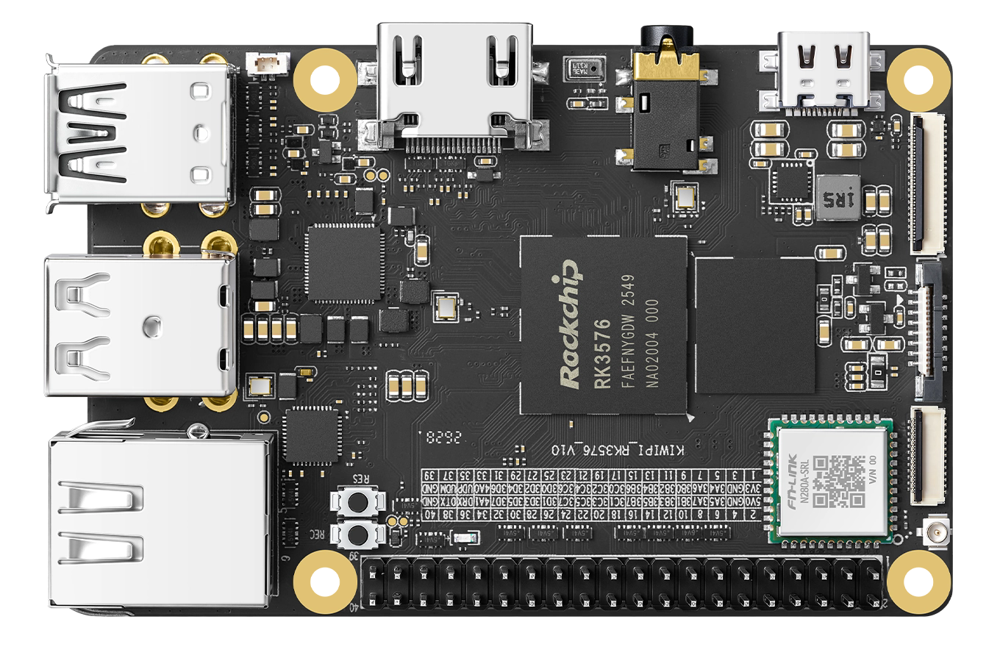

# KiwiPi 4

Official documentation, downloads and developer resources for KiwiPi 4, a Rockchip RK3576 single-board computer.

[KiwiPi website](https://kiwipi.com/) · [Product page](https://kiwipi.com/product/kiwipi-4/) · [Documentation center](https://kiwipi.com/document-center/?dc_tab=10210.1) · [Contact KiwiPi](https://kiwipi.com/contact-us/)

## Technical configuration

| Component | Configuration |
| --- | --- |
| SoC | Rockchip RK3576, 8 nm |
| CPU | 4 × Cortex-A72 at 2.2 GHz + 4 × Cortex-A53 at 1.8 GHz |
| GPU | Arm Mali-G52 MC3 |
| NPU | Up to 6 TOPS |
| RAM | 3 GB LPDDR4 |
| Onboard storage | 64 GB UFS |
| Storage expansion | microSD |
| Display interfaces | HDMI 2.1, USB-C DisplayPort Alt Mode, 4-lane MIPI-DSI |
| Camera interfaces | 2 × 4-lane MIPI-CSI |
| USB | USB-C OTG, 1 × USB 3.0 host, 2 × USB 2.0 host |
| Networking | Gigabit Ethernet, Wi-Fi 6, Bluetooth 5.4 |
| Audio | 3.5 mm headset jack and onboard microphone |
| Expansion | 40-pin header; consult the hardware manual for pin assignments |
| Power input | USB-C PD; follow the hardware manual for your board revision |
| Dimensions | 56 × 85 mm |
| Official OS downloads | Android 15, Ubuntu 24.04, Debian 12 |

Specifications are listed on the [official product page](https://kiwipi.com/product/kiwipi-4/). Refer to the matching hardware manual for revision-specific connector pinouts and electrical limits.

## Board layout

Images: [official KiwiPi 4 product page](https://kiwipi.com/product/kiwipi-4/).

## Start here

1. Identify your board model and hardware revision.
2. Read the [official user manuals](https://drive.google.com/drive/folders/1ExJgLoRKsR0Wwq-AxdJqJvDF36xP0HA4).
3. Choose an image from [Downloads](docs/downloads.md).
4. Follow the corresponding firmware installation instructions.

Use the designated power and data connectors described in your board manual. Back up storage before flashing.

## Documentation

- [Downloads and developer resources](docs/downloads.md)
- [Documentation guide](docs/documentation.md)
- [Official product specifications](https://kiwipi.com/product/kiwipi-4/)

## Support

[Contact KiwiPi](https://kiwipi.com/contact-us/) for product inquiries and help selecting resources for your board.

Third-party tools and Rockchip materials retain their respective authors' terms. Source archives may contain components under different licenses.
